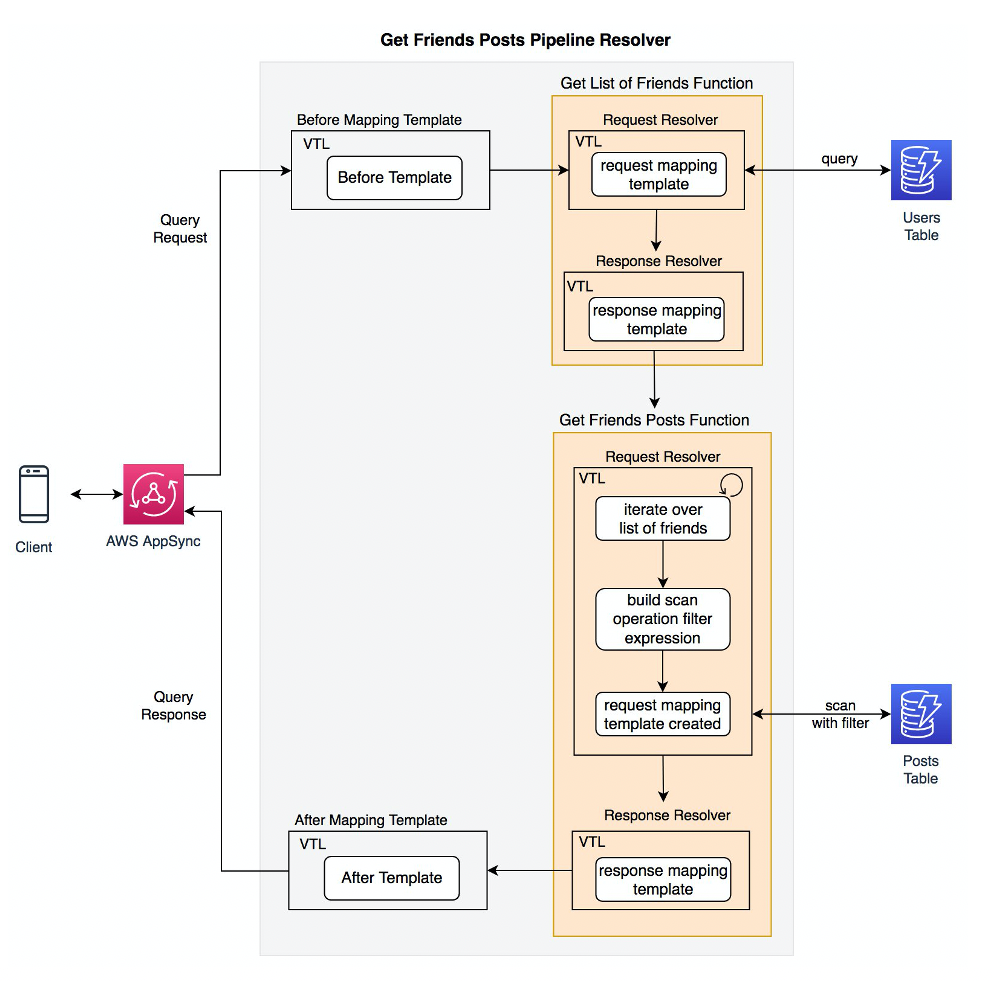

# AWS AppSync

[Back to index](../../README.md)

AWS AppSync is a fully managed service for building serverless GraphQL APIs. It connects mobile and web applications to backend data sources without storing the application data itself.

## GraphQL queries

Clients request exactly the fields they need, reducing unnecessary data transfer. A single GraphQL request can retrieve data from multiple sources, such as DynamoDB, Lambda, and Elasticsearch, instead of requiring several REST requests.

## Real-time updates and offline synchronization

AppSync uses WebSocket connections to push updates to connected clients. Chat applications and live voting displays can receive changes without polling or manually refreshing the screen.

With an offline-capable client integration, applications can cache data locally while disconnected, then synchronize changes and resolve conflicts when connectivity returns.

## Data sources

- **Amazon DynamoDB:** NoSQL data storage.
- **AWS Lambda:** Custom application logic.
- **Amazon Aurora:** Relational data.
- **HTTP APIs:** Other web services.

## Pipeline resolvers

A frontend can send a single GraphQL request whose field resolver runs several functions in sequence. For example:

1. Read a patient from the `Patients` table.
2. Use that patient's ID to query `MedicalRecords`.
3. Write an access record to `AuditLog`.

AppSync can access DynamoDB directly, removing the need for an intermediary Lambda function solely to orchestrate database operations. The `APPSYNC_JS` runtime supports JavaScript resolvers and functions; TypeScript source must be compiled to JavaScript before deployment. VTL is another resolver option.

The diagram shows a VTL pipeline that first queries the `Users` table for a list of friends, then iterates over that list to build a filtered scan of the `Posts` table. Each function has request and response mapping templates; before and after templates wrap the pipeline, and the combined response returns to the client through AppSync.

## Notes

### Coordinating reads and writes across DynamoDB tables

In a serverless healthcare application that retrieves and writes patient information across several DynamoDB tables, pipeline resolvers can coordinate those operations through one GraphQL endpoint. Direct integration reduces the application code and Lambda compute needed for this orchestration.

### Choosing related services

API Gateway with Lambda can also implement this workflow, but requires maintaining the Lambda code and managing its execution characteristics, including cold starts and compute charges while awaiting downstream operations.

Athena federated queries serve analytical workloads. Its DynamoDB connector does not provide the application writes needed by this workflow; Athena `INSERT INTO` writes supported results to S3 rather than updating DynamoDB tables.

CloudFront Functions are intended for lightweight edge request and response transformations, such as header changes, redirects, and token checks. They cannot make network calls to DynamoDB or other external APIs. The source describes their execution budget as a maximum of 1 millisecond; treat that numerical claim as source-era guidance rather than a verified current quota.
