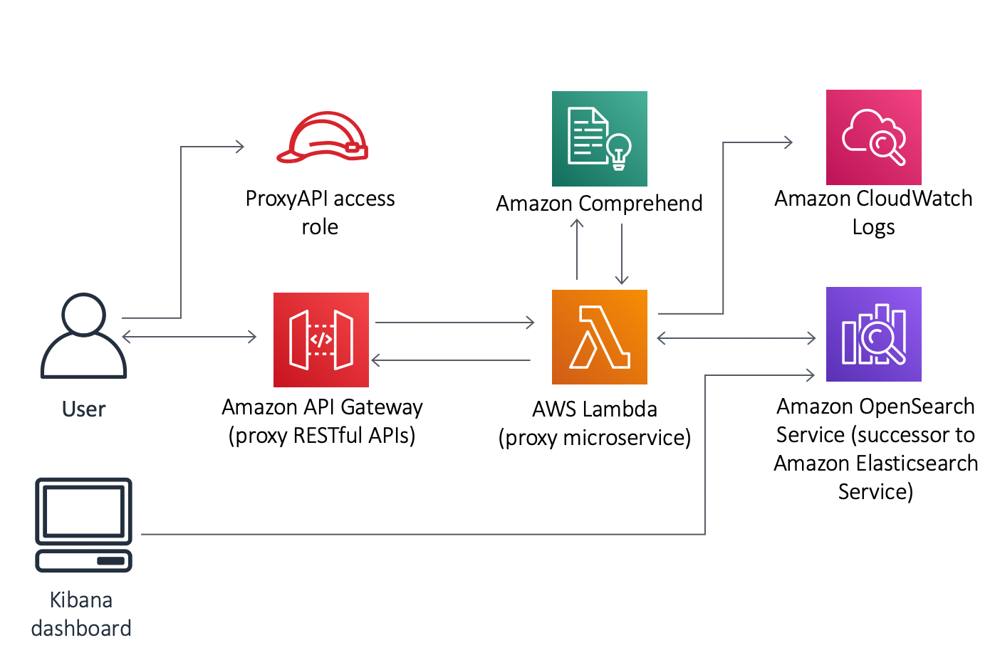

# Amazon Comprehend

[Back to index](../../README.md)

Amazon Comprehend uses machine learning for natural language processing (NLP), finding insights and relationships in unstructured text without requiring machine learning expertise.

## Core features

- **Sentiment analysis:** Classifies text as positive, negative, neutral, or mixed; useful for analyzing customer feedback about a new product.
- **Entity recognition:** Identifies people, organizations, locations, dates, quantities, and brands. For example, in “John from Amazon visited Hanoi,” it identifies John as a person, Amazon as an organization, and Hanoi as a location.
- **Key phrase extraction:** Extracts phrases that express the main ideas in a passage.
- **Language detection:** Identifies the language of the input text, such as English, French, or Spanish.
- **Custom classification:** Learns from labeled examples to categorize incoming text, such as routing software support emails to IT and pricing complaints to Sales.
- **Topic modeling:** Groups large document collections, such as 10,000 articles, into topics such as sports or politics.

## Notes

### Medical documents and PHI

For PDF medical reports stored in S3 by an existing API Gateway and Lambda application, use Amazon Textract to extract text and Amazon Comprehend Medical to identify protected health information (PHI). Calls to these managed services can be added to the existing Lambda function. Textract handles scanned documents and handwriting; Comprehend Medical analyzes medical text, including clinical entities such as medications and dosage. Clinical entities are not all automatically PHI. Comprehend Medical is HIPAA eligible; meeting HIPAA obligations also depends on application configuration and applicable agreements.

The source scenario also requires continuous monitoring of **S3 object-level API operations**. This is a separate audit requirement; its selected extraction and PHI-detection workflow does not implement that monitoring.

### Sentiment analysis of call transcripts

For customer-service conversations already transcribed into JSON files in S3, run a Comprehend analysis job, index the sentiment together with the transcript in Amazon OpenSearch Service, and visualize the result in **OpenSearch Dashboards**. This uses managed NLP and the search service’s native dashboard rather than training a custom NLP model. Textract extracts text from documents; it is not a sentiment-analysis engine.

### Text analysis and search

The diagram shows a user accessing a proxy REST API through API Gateway and an access role. Lambda calls Comprehend for text analysis, reads and writes OpenSearch data, and sends operational logs to CloudWatch Logs. A dashboard queries OpenSearch for visualization; the diagram uses the older **Kibana** label, while the accompanying workflow uses **OpenSearch Dashboards**.
