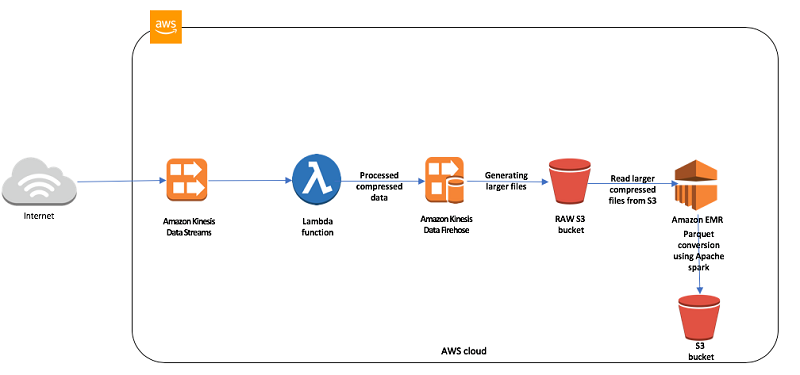
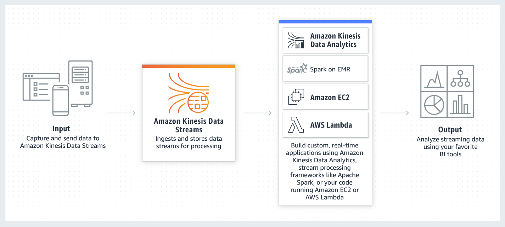

# Amazon Data Firehose

[Back to index](../../README.md)

Amazon Data Firehose is a managed service for delivering streaming data to storage and analytics destinations. It scales ingestion without requiring you to manage servers or delivery-stream shards.

## Delivery and transformation

- **Destinations:** Amazon S3, Amazon Redshift, Amazon OpenSearch Service, and supported third-party services such as Splunk and Datadog.
- **Transformation:** Invoke AWS Lambda to transform records before delivery. Firehose also supports converting JSON records to Parquet or ORC for efficient storage and analysis in S3.
- **Near-real-time delivery:** Buffer size and buffering interval control when records are delivered, trading delivery latency against efficiency.

This example sends internet data through **Kinesis Data Streams → Lambda → Data Firehose → a raw S3 bucket → EMR/Spark → a second S3 bucket**. Lambda processes and compresses records, Firehose combines delivery into larger files, and EMR converts the stored data into Parquet.

This comparison diagram shows **Kinesis Data Streams**, with consumers including Lambda, EC2, Spark on EMR, and the source-era Kinesis Data Analytics service. These consumers build custom real-time analytics for BI tools. It illustrates Data Streams processing options rather than Firehose delivery destinations.

## Notes

### Firehose versus Kinesis Data Streams

| Requirement | Suitable service |
|---|---|
| Managed delivery to S3, Redshift, OpenSearch, or Splunk | Data Firehose |
| Low-latency custom stream processing and replay | Kinesis Data Streams |

Kinesis Data Streams makes records available for processing with millisecond latency. Lambda consumers read batches from shards rather than invoking once per record; `BatchSize` supports up to **10,000 records**. Batching can increase throughput and reduce invocation overhead. Data Streams requires stream capacity and retention planning; Firehose manages delivery buffering.

For Firehose, Lambda is a **transformation hook**, not a delivery destination or a consumer that reads a Firehose stream. Use a Kinesis Data Streams consumer when Lambda must read stream records in batches.

S3 with Athena or Redshift Spectrum analyzes data at rest rather than serving as a low-latency stream consumer. Decoupling analytics ingestion with Kinesis can reduce application-tier load in an overloaded system returning HTTP 503 errors.

### Retention and delayed consumers

Kinesis Data Streams retains records for **24 hours by default**. If sensors send data daily but a consumer runs every **48 hours**, records older than 24 hours can expire before the consumer reads them. This can lose roughly half the records in that interval. Configure retention to exceed the longest expected consumer delay and allow for recovery time.
