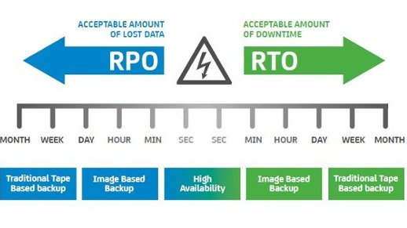

# Disaster Recovery

[Back to index](../../README.md)

The timeline illustrates **RPO** as the interval of potentially lost data before an incident and **RTO** as the time required to restore service after the incident.

## Recovery objectives

| Concept | Meaning | Planning measure |
|----|----|----|
| **RTO** (Recovery Time Objective) | Recovery time after failure | Maximum tolerable downtime |
| **RPO** (Recovery Point Objective) | Acceptable amount of data loss (calculated by time) | Maximum tolerable period of data loss |

---

## Disaster recovery strategies

### 1. Backup & Restore

- **Cost**: lowest

- **RTO/RPO**: longest

- **How it works**: Backup data to S3, restore when there is a problem

- **Modern services**: **AWS Backup** — centralizes and automates backups for EBS, RDS, DynamoDB, S3, on-premises; can copy cross-region backups

---

### 2. Pilot Light

- **Cost**: low — average

- **RTO/RPO**: faster than Backup & Restore

- **How it works**: Only keep **core components** (eg database) always running in DR region, application servers are turned off. When there is a problem → turn on app servers from existing AMI, route traffic to the recovery environment

- **Modern services**: **RDS Read Replicas, Aurora Global Database** as "pilot light" database, ready to promote

---

### 3. Warm Standby

- **Cost**: average

- **RTO**: several minutes

- **How it works**: Run a **scaled-down version** of production (e.g. 1 EC2 instead of 10). When there is a problem → scale up with **Auto Scaling**, Route 53 failover traffic

- Faster than Pilot Light because the environment is ready, just need to scale

---

### 4. Multi-Site (Active-Active)

- **Cost**: highest

- **RTO/RPO**: potentially near zero, depending on replication and failover design

- **How it works**: Run **full production** in **2+ AWS Regions** at the same time, traffic is load-balanced between regions. If one region fails, traffic automatically switches to the other region

- **Supporting services**: **DynamoDB Global Tables** for multi-region data, **Aurora Global Database** for cross-region replication, and **AWS Global Accelerator** for traffic routing. Aurora Global Database has a primary write Region; it is not a general multi-writer database.

---

## Illustrative recovery comparison

These are source examples rather than guaranteed service recovery times.

| Strategy | Cost | RTO | RPO | Features |
|----|----|----|----|----|
| **Backup & Restore** | 💲 | Hours → Days | Hours → Days | The simplest |
| **Pilot Light** | 💲💲 | Ten minutes | Minutes | Core is always running |
| **Warm Standby** | 💲💲💲 | Few minutes | Seconds → Minutes | The miniature environment is always available |
| **Multi-Site** | 💲💲💲💲 | Near 0 | Near 0 | Full Active-Active |

## AWS services supporting disaster recovery

| Service | Role in DR |
|----|----|
| **S3** | Save backup data, restore quickly |
| **Glacier** | Long-term storage, retrieval of several hours |
| **AWS Backup** | Centralize automatic backup |
| **Storage Gateway** | Copy on-premises snapshots to S3 |
| **AMI** | Preconfigured server images ready to launch |
| **ELB** | Distribute traffic to multiple instances |
| **Route 53** | Routing/failover traffic between sites |
| **Elastic IP** | Static regional address that can be reassociated during recovery within its scope |
| **VPC** | Private network environment, isolated |
| **Direct Connect** | Connect dedicated from on-premises to AWS |
| **RDS** | Relational database has the ability to scale |
| **DynamoDB** | NoSQL database, Global Tables for multi-region |
| **CloudFormation** | Automated, predictable infrastructure regeneration |
| **Server Migration Service** | Legacy source example for migrating on-premises servers to AWS |
| **Database Migration Service** | Migrate database + Schema Conversion Tool |
| **Redshift** | Data warehouse petabyte-scale |
| **Elastic Beanstalk** | Deploy and scale web applications |
| **Import/Export** | Legacy source example for transferring large datasets on physical devices |

## Notes

### AWS Elastic Disaster Recovery

**AWS Elastic Disaster Recovery (AWS DRS)** replicates data from on-premises servers to AWS at **block-level** almost continuously.

The source’s on-premises SQL Server application targets **RPO ≤ 60 seconds** and **RTO ≤ 1 hour**. It selects a pilot light design using DRS continuous replication to reduce standby cost while meeting those recovery objectives through an appropriately tested recovery plan.

Model:

    On-premises app + SQL Server
            ↓ continuous replication
    AWS DRS staging area
            ↓ during disaster
    Launch recovery instances on AWS

Strengths:

    RPO in seconds
    RTO is usually a few minutes to less than 1 hour
    No need to continuously run full production stack on AWS
    Lower cost than warm standby / active-active

DRS uses a **staging area** with minimal compute and cheaper storage. When there is a problem, it launches the actual recovery instances. This resembles a **pilot light** strategy: maintain a small replication environment and launch production recovery capacity when needed.
