# EC2

[Back to index](../../README.md)

## Introduction

The source contains historical prices, quotas, instance generations, and performance examples. These values are retained with that context and are not verified current purchasing limits.

- **Amazon EC2** is a virtual server based on **Linux / Windows / Mac** that you can automatically create (provision) according to your needs.

- Limit:
  - On-Demand Instances are limited by vCPU.

  - The source lists a historical Reserved Instance purchase limit of **20**; check the applicable current purchase quota.

  - Spot Instances according to the dynamic limits of each Region.

- **Amazon Elastic Compute Cloud (EC2)** is a web service that provides secure, scalable computing power in the cloud.

- Helps developers build web-scale applications easily, with complete control over computing resources on Amazon's proven infrastructure.

## Highlights

- **Regional deployment:** Available across AWS Regions and Local Zones; the source cites more than 30 Regions.

- **High security**: Verified boot with NitroTPM, network isolation via VPC.

- **Flexible**: Choose processor (Intel, AMD, Graviton) and payment model (Spot, On-Demand, Savings Plans).

## Features

- **AWS Nitro System**: New generation platform of EC2. Hypervisor functions (hardware protection, CPU virtualization, storage, networking) are transferred to specialized hardware and software → cost reduction, almost bare metal performance, better than the old Xen Hypervisor.

**Core components:**

- **Instances**: Virtual server environment.

- **Amazon Machine Images (AMIs)**: Reusable template containing OS + applications.

- **Instance types**: Different CPU, RAM, Storage, Networking configurations:
  - **t-type, m-type**: General purpose (general)

  - **c-type**: Compute optimized (CPU-intensive workloads)

  - **r-type, x-type, z-type**: Memory optimized (memory-intensive workloads)

  - **d-type, h-type, i-type**: Storage optimized (storage-intensive workloads)

  - **f-type, g-type, p-type, trn-type (Trainium), inf-type (Inferentia)**: Accelerated computing (GPU, AI, ML)

- **EC2 Instance Attestation**: Attestation with NitroTPM, checking instance identity and software integrity (Attestable AMIs) .

- **EC2 Instance Connect**: Connect to supported Linux instances over SSH using temporary public keys. RDP is the separate Windows remote-desktop connection mechanism.

- **Key pairs**: Secure login information.

- **Instance store volumes**: Temporary storage, deleted when STOP or TERMINATE instance.

  **Note**: Instance store-backed **does not support Stop**, only Start or Terminate.

- **EBS volumes**: Persistent storage (see Storage section).

- **Regions & Availability Zones**: Physical locations for deployment.

- **Security Groups**: Virtual Firewall, port, protocol, source IP regulations.

- **Elastic IP**: Static IPv4 address.

- **Tags**: Custom metadata attached to resources.

- **VPC**: Separate virtual network, can connect to on-premises network.

- **User data**: Initialization data, such as a shell script or cloud-init configuration; scripts normally run on first launch unless configured otherwise.

- **Host Recovery**: Automatically restart the instance on the new host when the Dedicated Host hardware fails.

- **EC2 hibernation:** Requires a supported instance/OS configuration and an encrypted EBS root volume. Historical source examples include M3/M4/M5, C3/C4/C5, R3/R4/R5, Amazon Linux, and Ubuntu 18.04 LTS; this is not an exhaustive current support matrix.

- **Automatically connect EC2 to RDS**.

## Instance states

| Status | Description | Payment | Important Note |
|----|----|----|----|
| **Running** | Running normally | Compute usage charges apply | Other resource charges also apply |
| **Stopped** | EBS remains; instance-store data is lost | No On-Demand compute usage charges | EBS, IP, and commitments can still cost money; some attributes can be changed |
| **Hibernated** | Save RAM to EBS, then stop | Storage, IP, and applicable commitment charges remain | Compute is charged during hibernation preparation; requires encrypted EBS |
| **Terminated** | Delete the instance | Compute usage ends; commitments and retained resources can still be billed | Cannot restart; root EBS deletion depends on DeleteOnTermination |

- Turn on **Termination Protection** to avoid accidental deletion.

- Turn on **Stop Protection** to avoid accidental stops.

## Root device volumes

- **EBS-backed Instances** (recommended):
  - Can Stop → Start without losing data.

  - When Stop can change instance type, kernel, user-data.

  - By default the root volume is deleted when Terminate (can be changed).

  - Support launching encrypted instances directly from unencrypted AMIs.

- **Instance Store-backed Instances**:
  - Stop is not supported.

  - Data is lost when Terminate or instance fails.

  - Must backup regularly.

## Amazon Machine Images

**AMI includes:**

- Template root volume (OS + applications)

- Launch permissions (usage rights)

- Block device mapping

| Features | EBS-backed AMI | Instance Store-backed AMI |
|----|----|----|
| Boot time | \< 1 minute | \< 5 minutes |
| Root device capacity | 64 TiB | 10 GiB |
| Root volume | EBS volumes | Instance store volume |
| Data Sustainability | The default root volume is deleted when terminated | Data only exists while the instance is running |
| Change properties | Can be changed when stopped | Cannot be changed |
| Stopped state | Support | Not supported |
| Create AMI | Use 1 command | Must use AMI tools |

- Can **copy AMI** between Regions.

- **Recycle Bin**: Restore deleted AMI, set lock rule to prevent accidental deletion.

- Public AMI is automatically deprecated after 2 years.

- Supports **UEFI Secure Boot**, **IMDSv2**, **EventBridge**.

## EC2 Image Builder

- Fully managed service, automatically creating, updating and deploying AMIs.

- Create custom images via Console, CLI or API.

- Automatically patch and update according to pipeline.

## Pricing

Discounts below are source examples; savings vary by configuration and purchase terms.

| Model | Description | Source maximum savings |
|----|----|----|
| **Savings Plans** | Fixed usage commitment (eg \$10/hour) 1 or 3 years | 72% |
| **On-Demand** | Pay per second, no commitment | \- |
| **Reserved Instances** | 1- or 3-year commitment with supported upfront-payment options | 60% |
| **Spot Instances** | Spare EC2 capacity; interruptions are possible | 90% |

**Reserved Instances comparison:**

| Type | Discount (1 year / 3 years) | Change Instance Family | Can be resold |
|----|----|----|----|
| Standard RI | 40% / 60% | No | Yes |
| Convertible RI | 31% / 54% | Yes | No |

**Spot Instances:**

- **Allocation strategy**: LowestPrice (default), Diversified, CapacityOptimized.

- **Spot Fleet**: Collection of multiple Spots + On-Demand.

- Can Stop/Start EBS-backed Spot Instances.

**Dedicated Hosts** support host-level isolation and eligible BYOL licenses. **Dedicated Instances** provide dedicated tenancy. **Capacity Reservations** reserve matching capacity in a specified AZ; these offerings serve different requirements.

## Security

- Use **IAM Roles** instead of keys in instances.

- **Security Groups**: Stateful firewall, only allow (no deny), default allows all outbound.

- Default Security Group: Allows all traffic between instances in the same group.

- Turn off password-based login, only use key pair.

- Support **ED25519 keys** for EC2 Instance Connect & Serial Console.

## Networking

- **Elastic IP**: Static IPv4, only used in Region.

- Default limit: 5 EIP/Region.

- **Elastic Network Interface (ENI)**: Can attach and detach (except primary eth0).

- **Enhanced Networking (SR-IOV)**: Increase bandwidth, reduce latency.

- **Elastic Fabric Adapter (EFA)**: For HPC and Machine Learning.

- **Bastion Host** (Jump box) for secure access to private instances.

## Monitoring

- **CloudWatch**:
  - Default: 5 minutes/metrics.

  - Detailed monitoring: 1 minute/metrics.

- System Status Checks & Instance Status Checks.

- CloudWatch Alarms, Events, Logs.

## Instance metadata and user data

- Access metadata: `http://169.254.169.254/latest/meta-data/`

- User data: `http://169.254.169.254/latest/user-data`

- User data limit **16 KB** (shell script or cloud-init).

- Tags can also be read from metadata.

## Placement groups

The illustration compares proximity, hardware isolation, and partition fault domains. Cluster placement favors network performance within one AZ. Spread placement separates racks and supports multiple AZs. Partition placement isolates groups of racks, supports multiple AZs, and exposes partition identity through instance metadata. The source graphic contains translated source labels; the English descriptions below provide its meaning.

### 1. Cluster Placement Group

Place instances close together **within one Availability Zone**. This does not guarantee that they share a single rack or physical host. The goal is low inter-instance latency and high throughput; the source illustrates 10 Gbps enhanced networking.

**Use when:** HPC workloads, ML training, big data jobs need extremely fast node-to-node communication.

**Risk:** If that rack/AZ crashes, multiple instances can be affected together.

---

### 2. Spread Placement Group

Distribute instances into **separate physical racks**, possibly across multiple AZs. Each AZ only allows a maximum of **7 instances per placement group**.

**Used when:** Critical applications need high availability, where each instance must be independent of each other in terms of hardware (eg primary DB, secondary DB, standby).

**Limit:** Hard limit 7 instances/AZ so cannot scale large.

------------------------------------------------------------------------

### 3. Partition Placement Group

Divide instances into **partitions** (rack groups). Partitions do not share hardware with each other — if one partition fails, the other partitions will still function. Each AZ allows up to **7 partitions**, each partition can contain hundreds of instances. In particular, instances can **query metadata API to know which partition they are in**, helping the application self-coordinate data.

**Used when:** Distributed storage systems like HDFS, Apache Kafka, Cassandra, HBase — where the application manages the fault domain itself.

## Storage

- **EBS**: Persistent block storage.

- **Instance Store**: Temporary, lost when stopped/terminate.

- **EFS**: File storage shared by multiple instances.

- **FSx**: Windows File Server, Lustre, ONTAP, OpenZFS.

- **S3**: Underlying storage for EBS snapshots and instance-store-backed AMI bundles.

## Tagging and resource IDs

- All EC2 resources (instances, volumes, snapshots, AMIs...) have unique IDs according to Region.

- **Tags** (key-value) can be attached for management.

## ECS extensions

- **ECS Anywhere**: Run ECS tasks on on-premise (External Instances) via SSM Agent.

- **ECS Service Connect**: Service discovery, traffic management, automatic observability for containers on EC2/Fargate.

------------------------------------------------------------------------

## Notes

### Stop/start behavior and persistent charges

For an instance scheduled to run from **08:00 to 18:00** and stop overnight, stopping loses all attached instance-store data. Starting can place the instance on a different underlying host. The primary ENI and an associated Elastic IP are retained through a normal stop/start cycle.

Stopping an On-Demand instance ends its compute usage charge, including usage-based OS licensing bundled with that compute. EBS volumes, snapshots, Elastic IP/public IPv4 addresses, load balancers, and other independent resources can still incur charges. The source's statement that a single attached Elastic IP is free while running reflects historical pricing; it is not a current pricing assumption. The source cites approximately **$0.005 per hour** for a retained IP on a stopped instance.

Creating a VPC, subnets, route tables, security groups, or an internet gateway does not itself incur a base VPC charge. Charged components such as NAT gateways, Transit Gateway, and applicable data transfer are separate.

### Reserved Instance commitments after decommissioning

An RI is a **billing commitment**, typically for one or three years, rather than a particular virtual machine. Terminating or stopping an instance does not cancel that commitment. All-upfront charges are not automatically refunded; remaining partial-upfront or no-upfront recurring charges continue under the contract.

For a decommissioned workload, terminate unused instances and clean up unneeded attached resources. If a still-running instance outlives its matching RI, its uncovered usage is billed at the applicable On-Demand rate; a stopped instance does not suddenly incur compute usage merely because the RI expires.

An eligible **Standard RI with remaining term** can be sold through the EC2 Reserved Instance Marketplace to recover some committed cost. Expired reservations cannot be sold, and Convertible RIs are not eligible for this resale path.

### Hibernation for applications with long startup times

Hibernation writes RAM contents to the encrypted EBS root volume. Resuming restores the application's prior in-memory state, avoiding a full restart and reload. This can help Windows applications using FSx for Windows File Server, Java applications, and other workloads that take several minutes to initialize.

Hibernation must be enabled **when launching** a supported instance. For an existing instance without it, migrate the workload to a newly launched instance with hibernation enabled. Changing the OS or disabling instance metadata does not address restoring application memory state.

Normal stopping does not incur On-Demand compute usage charges during `stopping`. Preparing to **hibernate** does incur compute charges while in `stopping`, until RAM has been saved. Once stopped, storage and other independent charges remain.

### Regional vCPU quotas

If a script requests **50 instances** and only **20** launch, inspect the Region's On-Demand **vCPU-based quota** for the relevant instance category. The first 20 may consume the available vCPUs; this does not establish a universal 20-instance-per-AZ limit. The source names `InstanceLimitExceeded` as a possible quota error. Request an increase through Service Quotas or AWS Support, then retry the remaining **30** launches after approval.

### Instance metadata for shell scripts

Obtain instance public and private IP information from instance metadata at `http://169.254.169.254/latest/meta-data/`, using a client such as `curl` and the required metadata-service authentication flow for the instance configuration. User data is initialization input, not the endpoint for current IP metadata.

### Instance-family reference

The following transcribes the source's instance-family illustration:

| Family | Category | Main characteristics |
| --- | --- | --- |
| C | Compute optimized | Cost-effective performance per unit of compute |
| D | Storage optimized | High disk throughput |
| F | Accelerated computing | Reconfigurable FPGA acceleration |
| G | Accelerated computing | Graphics-intensive GPU workloads |
| H | Storage optimized | HDD-based local storage for high throughput |
| I | Storage optimized | Low-latency storage, high random I/O, sequential read throughput, and IOPS |
| M | General purpose | Fixed-performance general workloads |
| P | Accelerated computing | General-purpose GPU acceleration |
| R | Memory optimized | Memory-intensive applications |
| T | General purpose | Burstable performance |
| X | Memory optimized | Large enterprise in-memory applications and high-performance databases |

For a replicated NoSQL database prioritizing high IOPS and sequential read/write throughput, storage-optimized instances with local instance-store storage are a useful fit. Source examples include **I3, I3en, I4i, D2, and D3**; their storage media and performance differ by family. Local storage avoids EBS's network path, but it is ephemeral and requires the workload's replication or another durability strategy. It is not universally faster than every EBS configuration.

Other source workload examples include R for Redis/SAP HANA, C for video processing, batch jobs and gaming, I/D for NoSQL, warehouses and logs, and M/T for web servers and development.

### Preserving logs before Auto Scaling termination

For instances behind an ALB that fail HTTPS health checks, use a termination lifecycle hook to pause at **`Terminating:Wait`**. Match the **EC2 Instance-terminate Lifecycle Action** event with EventBridge and invoke Lambda to coordinate CloudWatch Agent log delivery. Complete the lifecycle action after logs reach CloudWatch Logs. This preserves evidence before ephemeral instance data disappears; waiting for a termination-success event is too late.

### Windows remote desktop access

When the public IP, internet gateway, and route tables are already correct, verify that the instance security group permits inbound **TCP 3389** from the company's source IP range. Port 22 is for SSH rather than Windows RDP.

### Adding instances to a cluster placement group

An **insufficient capacity** error while expanding an existing cluster placement group can mean AWS cannot place additional instances close to the current ones. Stop and restart the group's instances, then retry the expansion so placement can be reconsidered on available hardware. This is a placement-capacity issue, distinct from a regional vCPU quota.

### Capacity reservations for scheduled financial processing

For uninterrupted financial calculations running nightly from **22:00 to 03:00**, reserve matching EC2 capacity in the required AZ. The source illustrates **10 `m6i.2xlarge` instances in `ap-southeast-1a`**. Matching instances can consume an active On-Demand Capacity Reservation; unused reserved capacity is also billable. Cancel an unneeded reservation after the job to stop its reservation charges.

The screenshot describes capacity being available on a recurring schedule. A standard On-Demand Capacity Reservation does not itself create an automatic recurring reservation schedule; its creation/cancellation or another supported reservation mechanism must be arranged explicitly.

### Choosing a commitment for intermittent workloads

Convertible RIs allow exchanges that can change instance family, subject to exchange rules. Long-lived predictable workloads can benefit from RI commitments. Short, interruption-intolerant work can use On-Demand capacity without a multiyear commitment.

A quarterly job using **15 instances**, running over **five days** for **five uninterrupted hours per day**, illustrates the latter case: the short total runtime does not by itself justify an RI, and Spot interruptions conflict with the requirement.

A historical source example runs continuously Tuesday through Sunday and for **eight hours on Monday**. It pairs Standard RIs for the continuous portion with **Scheduled Reserved Instances** for Monday. Preserve this as historical guidance: Scheduled Reserved Instances are a legacy purchasing model and should not be treated as a current recommendation.

### Auto Scaling replacement versus AZ rebalancing

In the source's two-AZ `us-east-1` deployment, manual terminations leave the AZs unbalanced and another instance fails an ALB health check. For unhealthy-instance replacement, the described sequence is **terminate the unhealthy instance, then launch its replacement**. For **AZ rebalancing**, Auto Scaling **launches in the underrepresented AZ before terminating an old instance**, preserving capacity during the balancing operation. Replacement timing can also depend on the group's configured maintenance policy.
