# Amazon ElastiCache

[Back to index](../../README.md)

## Redis cluster modes

The illustration contrasts one unsharded primary with multiple shards. Each shard has a primary and can have read replicas. The English comparison below explains the diagram’s labels.

| Characteristic | Cluster mode disabled | Cluster mode enabled |
|---|---|---|
| Shards | One shard. | Multiple shards for horizontal partitioning. |
| Hash slots | All **16,384** slots belong to the one primary. | Slots are distributed across shard primaries. |
| Scaling | Increase primary capacity vertically; replicas support reads. | Add shards for horizontal capacity and throughput. |
| Endpoint | Primary endpoint for writes; replicas are read-only. | Configuration endpoint with a cluster-aware client. |
| Failover | Fail over the single shard to a replica. | Fail over each shard independently. |
| Multi-key operations, Lua, and transactions | Keys reside on the same shard. | Related keys must be in the same hash slot for operations that require it. |
| Client | Standard Redis client. | Cluster-aware Redis client. |
| Typical use | Simpler deployments with smaller data sets. | Larger data sets and higher throughput. |

The three-shard example assigns slots **0–5460**, **5461–10922**, and **10923–16383**. The diagram identifies the Redis cluster bus port as **16379** and cites a maximum of **500 shards**. It also uses **6.5 GB** as an illustrative small-data threshold; this is not a universal limit for cluster mode disabled. Limits and eligible configurations should be checked for the chosen engine and node type.

## Notes

### Password authentication and encryption in transit

For the source’s ElastiCache for Redis authentication scenario, create the cluster with both **`--transit-encryption-enabled`** and **`--auth-token`** configured. Redis **AUTH** requires a token before clients execute commands, while encryption in transit protects that token and data on the network.

Enabling encryption at rest alone does not require clients to authenticate. Authentication is not automatically enabled merely by creating a Redis cluster.
