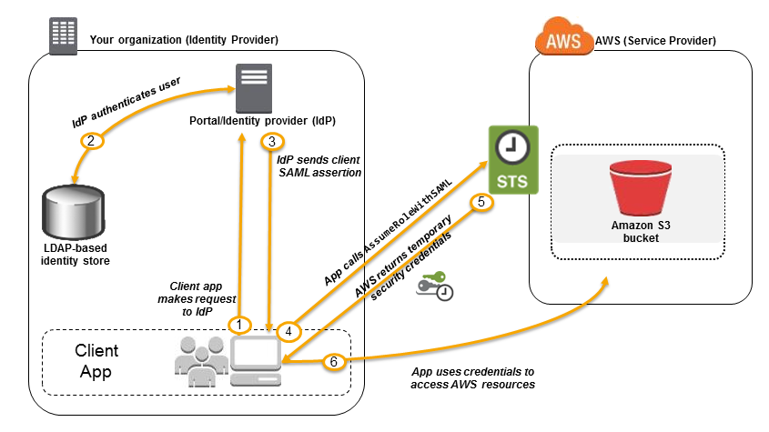

# AWS Identity and Access Management (IAM)

[Back to index](../../README.md)

Source attribution: [Tutorials Dojo](https://tutorialsdojo.com/), as credited in the original notes.

IAM controls authentication and authorization for AWS resources. It is a global service with no additional IAM charge. Its resources are available across Regions; configuration changes propagate and may not be immediately consistent everywhere.

## Identities and principals

| Identity | Description |
|---|---|
| **Root user** | Account identity with broad privileges, including root-only tasks. Protect it and avoid daily use; applicable organization controls can still restrict member-account root users. |
| **IAM user** | Identity within one account that can have a console password and long-term access keys. Prefer federation or IAM Identity Center for workforce access. |
| **IAM group** | Collection of users for assigning permissions. A group is not a principal, cannot sign in, has no credentials, and cannot contain other groups. A user can belong to multiple groups. |
| **IAM role** | Identity assumed by a trusted principal to obtain temporary credentials; it has no permanent password or access keys. |

### Roles and instance profiles

- **Service role:** Allows an AWS service to act on your behalf.
- **EC2 service role:** Provides permissions to an EC2 instance.
- **Service-linked role:** An AWS service defines its required permissions and trust relationship.
- **Instance profile:** Container used to pass an IAM role to EC2. SDKs can then obtain temporary credentials without embedded access keys.

## Policies

A JSON policy statement specifies an **Effect** (`Allow` or `Deny`), **Action** (API operations), and **Resource** (target resources), with conditions where required.

| Policy type | Purpose |
|---|---|
| **Identity-based** | Attached to a user, group, or role; defines permitted actions. |
| **Resource-based** | Attached directly to a resource, such as an S3 bucket; identifies principals and can support cross-account access. |
| **Permissions boundary** | Limits the maximum permissions an IAM user or role can receive; grants no permissions by itself. |
| **Trust policy** | Role resource policy identifying who can assume the role. |

A **managed policy** is a reusable standalone policy attached to multiple identities. An **inline identity policy** is embedded in one identity. Resource policies are attached to resources rather than managed-policy attachments.

### Evaluation

1. An applicable **explicit deny** overrides an allow.
2. Access needs the required allow and must satisfy applicable boundaries, organization policies, and other policy evaluation rules.
3. With no applicable allow, access is **implicitly denied**.

New IAM users have no permissions by default. A password provides console authentication; access keys provide programmatic authentication. Granting a policy alone does not create credentials.

## Federation and temporary credentials

An organization can federate identities from an existing authentication system and use IAM roles to grant AWS access.

AWS Security Token Service (STS) generates short-lived, limited-privilege credentials dynamically. It has the global endpoint `https://sts.amazonaws.com` and Regional endpoints.

| STS API | Purpose |
|---|---|
| `AssumeRole` | Obtain credentials for a trusted role in the same or another account; can include MFA. |
| `AssumeRoleWithSAML` | Exchange an enterprise SAML assertion for role credentials. |
| `AssumeRoleWithWebIdentity` | Exchange a supported web identity/OIDC token for role credentials. |
| `GetFederationToken` | A trusted broker uses IAM user credentials to request a federated-user session. |
| `GetSessionToken` | Obtain a temporary session, commonly with MFA for programmatic requests. |

Session lifetimes depend on the STS API, principal, and role configuration. The source's custom broker example uses a **15-minute to 12-hour** range; it is not a universal limit for every API.

## IAM Access Analyzer

- Validates policies and reports errors, warnings, and actionable recommendations.
- Analyzes supported resource policies for external access, including S3, KMS, SQS, IAM roles, Lambda, and Secrets Manager.
- Identifies public or cross-account sharing with principals outside the configured trust zone.

## IAM Identity Center

IAM Identity Center, formerly AWS SSO, centralizes workforce sign-in and access to multiple accounts. An organization instance uses one identity source: the Identity Center directory, Active Directory, or an external identity provider.

- **Permission sets:** Define account access for users and groups across multiple accounts.
- **ABAC:** Uses identity/resource attributes to reduce the need for many separate policies or permission sets.
- **Delegated administration:** Reduces the need for routine management-account access.
- **Application assignments:** Supports SaaS applications, Identity Center-enabled applications, and custom SAML 2.0 applications.
- **AWS CLI v2:** Supports federated workforce access without requiring permanent IAM user keys.

## Request processing

| Element | Meaning |
|---|---|
| **Principal** | User, role session, federated user, application identity, or service making a request. |
| **Request context** | Actions, resources, principal information, environment information, and resource attributes. |
| **Authentication** | Establishes identity using console sign-in, signed API requests, or federation. |
| **Authorization** | Evaluates applicable policies to allow or deny the request. |

## Access patterns

- **Human access:** Prefer Identity Center or federation. IAM users can serve cases without another identity mechanism; CLI use alone does not require an IAM user.
- **EC2 access to S3:** Attach a role with S3 permissions through an instance profile so the SDK obtains temporary credentials.
- **Cross-account access:** Create a role in target Account B, trust the appropriate principal in Account A, and authorize that principal to call `AssumeRole`. Supported resource policies can also provide cross-account access.
- **Mobile/web sign-in:** Use Cognito or an appropriate web identity integration to exchange supported provider tokens, such as Google or Facebook sign-in, for temporary AWS credentials.
- **Central billing access:** Create a role in the organization **management account** and allow authorized member-account principals to assume it.

## Security practices

- Protect root credentials, delete root access keys, enable MFA, and reserve root use for tasks that require it.
- Apply least privilege and policy conditions.
- Use roles for EC2, Lambda, and ECS applications; avoid hard-coded credentials.
- Enforce MFA for sensitive human access, especially administrators.
- Use groups for shared IAM user permissions.
- Rotate long-term keys where they remain necessary and delete unused credentials.
- Monitor account activity and review access regularly.

## Notes

### Enterprise SSO and per-user S3 prefixes

For a workforce such as **1,200 employees** using an existing AD/LDAP directory, an identity provider or federation proxy can obtain temporary STS credentials. A shared role and suitable policy variables or identity attributes can restrict each employee to a designated S3 prefix, avoiding 1,200 separate IAM users or policies.

The source illustrates `my-bucket/${aws:username}/*`, but `aws:username` is not generally available for assumed-role or federated sessions. Bind the S3 prefix to a trusted attribute supported by the chosen federation model; do not copy that variable blindly into a federated-role policy.

The identity provider authenticates the user against the corporate directory, issues a SAML assertion, and exchanges it through AWS STS for credentials the application uses to access AWS resources.

### Legacy LDAP without SAML

When an identity store cannot issue SAML assertions, a **custom identity broker** can authenticate the user against LDAP, then call STS (`AssumeRole` or `GetFederationToken`, as appropriate) and return short-lived credentials. SAML-capable workforce providers can use SAML federation or Identity Center; consumer web identities commonly use Cognito/OIDC.

Third-party identity providers can also integrate with corporate directories; the source's example chooses direct federation without requiring a separate third-party product. WorkDocs does not configure per-user S3 permissions for an application.

### Group permissions and MFA

For frequently added employees, create department groups such as HR, Development, and Sales, attach least-privilege policies, and add users to the appropriate group. MFA enforcement can use the `aws:MultiFactorAuthPresent` condition. Its presence depends on credential type, so design missing-key behavior and necessary MFA-enrollment exceptions deliberately.

### Organization guardrails and permissions boundaries

| Control | Scope | Purpose | Grants permissions? |
|---|---|---|---|
| **Service control policy (SCP)** | Organization root, OU, or account | Constrains permissions across member accounts; management-account principals and some special cases are exempt | No |
| **Permissions boundary** | IAM user or role | Limits one identity's effective permissions, useful for delegated IAM administration | No |

An SCP can restrict EC2 use outside `ap-southeast-1`. A permissions boundary can constrain a developer role so that attaching an administrator policy does not expand effective permissions beyond the boundary. Permissions to attach policies and to modify/remove boundaries must also be controlled when delegating IAM administration.
