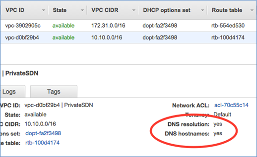

# Amazon Route 53

[Back to index](../../README.md)

The numerical quotas and health-check timings below are source references rather than verified current limits.

## Overview

- DNS web service: **domain registration, DNS routing, health checking**

- Supports hybrid DNS (on-premises ↔ AWS), IPv4/IPv6 dual-stack

- Supports **DNS over HTTPS (DoH)**, DNSSEC

- **Route 53 Profiles**: centralized cross-account DNS management

------------------------------------------------------------------------

## Routing Policies

| Policy | Use when |
|----|----|
| **Simple** | 1 resource, can return multiple IP |
| **Failover** | Active-Passive failover |
| **Geolocation** | Routing by **user location** |
| **Geoproximity** | Routing by user/resource geography and distance, with bias to adjust coverage |
| **Latency** | Choose the region with **lowest latency** |
| **Weighted** | Divide DNS responses by relative weights (for example, 70/30) |
| **Multivalue** | Returns up to **8 random healthy records** |
| **IP-based** | Routing based on user's **IP range** |

------------------------------------------------------------------------

## Alias vs CNAME

|  | **CNAME** | **Alias** |
|----|----|----|
| Zone apex | ❌ Unable to use | ✅ Usable |
| Query fee | Chargeable | **Free** for eligible AWS alias targets |
| Point to | Any DNS | Supported AWS targets or records in the same hosted zone |
| Show | Displayed as CNAME | Displays the correct record type (A/AAAA) |

> Supported Alias: **CloudFront, ELB, S3 website, API Gateway, Elastic Beanstalk, VPC endpoints, OpenSearch, App Runner, VPC Lattice**

------------------------------------------------------------------------

## Hosted Zones

| Type | Description |
|----|----|
| **Public Hosted Zone** | Routing traffic from the internet |
| **Private Hosted Zone** | Routing in VPC (needs `enableDnsHostnames` + `enableDnsSupport` enabled) |

- A public hosted zone is assigned **four name servers** for delegation.

- **Split-view DNS**: the same domain can return different answers through public and private DNS views.

- Public hosted-zone query logging is separate from **Resolver query logging**, which can record VPC DNS queries.

------------------------------------------------------------------------

## Health Checks

### Health check type

| Type | Request |
|----|----|
| **HTTP/HTTPS** | TCP connect in **4 seconds**, returns 2xx/3xx in **2 seconds** |
| **TCP** | TCP connect in **10 seconds** |
| **HTTP/HTTPS + String matching** | Like HTTP/HTTPS + receive response body in the next **2 seconds** |

### Health-check targets

- Specific endpoint (IP or domain)

- Other health checks, combined in a calculated health check

- CloudWatch alarm

### Failover

| Type | Description |
|----|----|
| **Active-Active** | Multiple resources serve traffic; unhealthy resources are excluded when healthy alternatives are available |
| **Active-Passive** | Primary serves traffic; secondary is selected when the primary is unhealthy |

---

## Route 53 Resolver

- Respond to DNS queries for **VPC domain names** (EC2, ELB,...)

- Perform recursive lookup for public domains

- **Inbound endpoint**: receives queries from on-premises into AWS

- **Outbound endpoint**: forward queries from EC2 to on-premises

- **Resolver is regional**

### DNS Firewall

- Block malicious domains via **blocklist**

- Allow trusted domains via **allowlist**

- Send findings to **Security Hub**, alerts via **EventBridge**

------------------------------------------------------------------------

## Types of DNS Records

| Record | Description |
|--------------------------|------------------------------------------|
| **A** | IPv4 address |
| **AAAA** | IPv6 address |
| **CNAME** | Domain Alias |
| **MX** | Mail server (priority + domain) |
| **NS** | Name server of the hosted zone |
| **SOA** | Information about domain/hosted zone |
| **TXT** | Text info (SPF, DKIM,...) |
| **CAA** | Specifies the CA authorized to issue cert |
| **SRV** | Priority, weight, port, domain |
| **PTR** | Reverse DNS lookup |
| **HTTPS/SVCB/TLSA/SSHFP** | Additional DNS record types supported in the source |

------------------------------------------------------------------------

## Traffic Flow

- Visual editor creates complex routing policies

- Combine many routing policies: geolocation, geoproximity, weighted, latency, failover, multivalue

- Create **traffic policy** → attach to **policy record** in hosted zone

------------------------------------------------------------------------

## Monitoring

- **CloudWatch**: DNS query metrics, health check metrics

- **CloudTrail**: log API calls

- **Route 53 Dashboard**: domain registration status, transfer, about to expire

- Maximum **500 health check metrics**/CloudWatch namespace, **100 health checks**/account

------------------------------------------------------------------------

## Pricing

- **Hosted zone**: charged when created + first of each month (free if deleted within the first **12 hours**)

- **Free Alias queries** when pointing to: ELB, CloudFront, S3 website, API Gateway, Elastic Beanstalk, VPC endpoints

- **CNAME queries**: chargeable

- Domain name: price according to **TLD**

- Traffic flow policy record: charged monthly

## Notes

### Adjusting geographic coverage with bias

Geoproximity routing uses the locations of users and resources to choose an endpoint. **Positive bias (1 to 99)** expands a resource's geographic coverage; **negative bias (-1 to -99)** shrinks it. This differs from geolocation routing, which maps named locations such as countries or continents to records.

For a messaging application in `ap-northeast-1` (Tokyo) and `ap-southeast-2` (Sydney), increase Tokyo's bias to shift a larger share of users from areas such as the Philippines and northern India toward Tokyo. This changes a geographic boundary rather than assigning a fixed percentage to those countries.

### Custom domains for S3 websites

Direct Route 53 routing to an S3 website endpoint requires a registered domain and a bucket whose name exactly matches the requested hostname. For example, `www.yourcompany.com` must map to the website bucket `www.yourcompany.com`. S3 uses the HTTP `Host` header to identify the bucket.

The domain can be registered through Route 53 or another registrar, provided DNS delegation is configured correctly. Public hosted zones are global, so the S3 bucket need not be in a “hosted-zone Region.” Select the bucket's actual Region when choosing the S3 website alias target. This direct S3 website arrangement is distinct from an architecture using CloudFront in front of S3.

### Active-active regional availability

For a multi-Region money-transfer service that should use all deployed resources continuously, use an **active-active** arrangement, such as weighted records with health evaluation. Relative weights distribute responses across healthy destinations, and unhealthy destinations can be excluded so remaining healthy Regions receive traffic.

Weighted, latency, geolocation, and multivalue policies can support active-active designs. The named **failover routing policy** instead selects a primary or secondary destination for active-passive operation. Configure endpoint health checks or supported alias target health evaluation as appropriate. DNS caching, detection timing, and all-targets-unhealthy behavior mean traffic shifts are not instantaneous or an unconditional guarantee that an unhealthy record is never returned.

### Pre-provisioning for regional recovery

For an application using an EC2 Auto Scaling group behind an ALB and a DynamoDB table, pre-create the ALB and compute stack in a secondary Region and use **DynamoDB global tables** for cross-Region data replication. Route 53 health-based failover can direct clients to the prepared secondary stack after a primary-Region failure. Active-active or warm-standby capacity reduces recovery time compared with provisioning the entire environment only after the failure.

A **global secondary index** is an index of a DynamoDB table; it does not provide a separate cross-Region recovery copy. Global-table replication is not necessarily instantaneous, so select the consistency mode and recovery objectives deliberately.

Use the **AWS Well-Architected Tool** for architecture reviews against the framework's six pillars and recommendations for improvement. Prometheus and Grafana focus on observability rather than replacing that review. Compute Optimizer focuses on resource sizing and configuration recommendations rather than reviewing the full architecture. CloudFormation can reproduce infrastructure, but deploying a complete stack only after an outage adds provisioning time.

### EC2 DNS hostnames

An EC2 instance in a default VPC commonly receives private and public DNS hostnames corresponding to its private and public IPv4 addresses. For a custom VPC, enable **`enableDnsSupport`** (DNS resolution) and **`enableDnsHostnames`** when public DNS hostnames are required. The instance must also have a public IPv4 address. A private DNS hostname alone does not imply the instance has public DNS access.

The console illustration shows VPC DNS settings. DNS resolution and DNS hostname configuration control whether the VPC supplies the corresponding instance DNS functionality.

### Pointing a zone apex to an ALB

A standard CNAME cannot be used at the zone apex, such as `company.com`. Use a **Route 53 A alias record** targeting the ALB's DNS name. A CNAME can be used at a suitable subdomain, such as `www.company.com`.

Do not hard-code the ALB's current IP addresses into an ordinary A record: those addresses can change as the load balancer scales. The alias returns the current target addresses while retaining a record type valid at the apex. Alias queries to eligible AWS resources, including ALB, CloudFront, and S3 website targets, have no Route 53 DNS-query charge.

### TLS for an apex and country subdomains

For public websites such as `example.com`, `country1.example.com`, and `country2.example.com` behind an ALB, request an **ACM public certificate** covering both `example.com` and `*.example.com`. A wildcard covers the single-level country subdomains but not the apex itself. Validate domain ownership by adding ACM's required DNS records at the DNS provider, then configure the certificate on the ALB's HTTPS listener.
