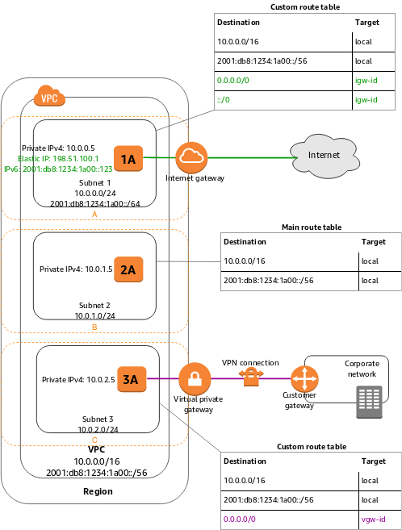
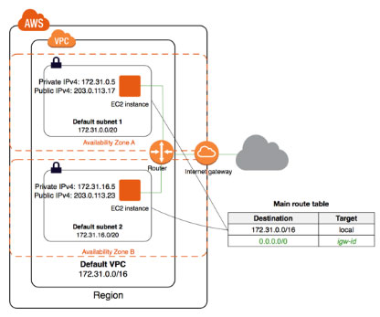
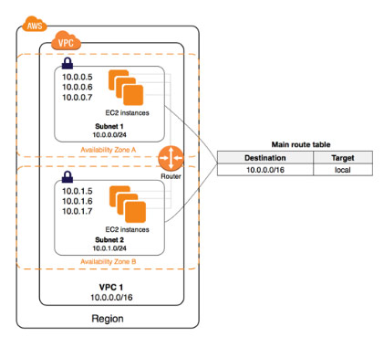
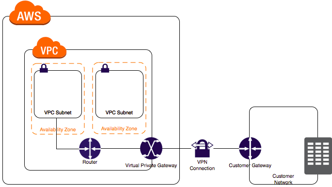
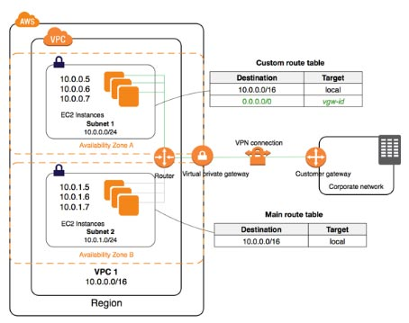
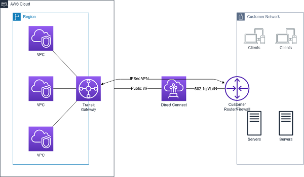
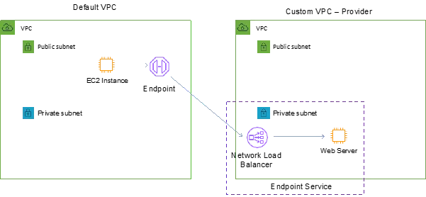

# Amazon Virtual Private Cloud

[Back to index](../../README.md)

## Overview

Amazon Virtual Private Cloud (VPC) provides a logically isolated virtual network for resources in an AWS account. A VPC is **regional** and can contain subnets across the Region’s Availability Zones. Each **subnet belongs to one AZ**.

A VPC combines IP address ranges, subnets, route tables, and security controls. It supports IPv4 and IPv6, with separate addressing and routing configuration for each protocol.

## Addressing and subnet types

- IPv4 VPC CIDR block sizes range from **`/16`**, with **65,536 addresses**, to **`/28`**, with **16 addresses**.
- A subnet’s CIDR must lie **within** a VPC CIDR and must not overlap another subnet’s CIDR.
- AWS reserves **five IPv4 addresses per subnet: the first four and the last**.
- A subnet’s CIDR cannot be resized in place. Create another subnet to add address capacity.
- Additional **secondary VPC CIDRs** can expand available space. Check restrictions and avoid overlap with peered networks.

| Subnet type | Routing characteristic |
|---|---|
| Public | Has a route to an internet gateway. IPv4 instances also need a public IPv4 address or Elastic IP for direct internet communication. |
| Private | Has no direct internet-gateway route. It can use NAT for outbound internet access. |
| VPN-only | Routes external traffic through a virtual private gateway for connectivity to a corporate network. |

Common designs include a public-only subnet, public and private subnets with NAT, public/private subnets plus managed VPN, or private-only subnets with managed VPN.

[Public and private subnet configuration example](public-and-private-subnets/README.md)

## Route tables

Each subnet is associated with **one route table**. New subnets use the VPC’s **main route table** unless explicitly associated with a custom table. A route table can serve multiple subnets.

- Local routes support communication within the VPC.
- Routing uses the **longest matching destination prefix**.
- **`0.0.0.0/0`** is an IPv4 default route, for example to an IGW from a public subnet or to NAT from a private subnet.
- **`::/0`** is an IPv6 default route. Use an **egress-only internet gateway** when external hosts must not initiate IPv6 connections.
- **VPC Route Server** supports dynamic route exchange for supported routing designs.

### Diagram: public, isolated, and VPN-routed subnets



The diagram uses VPC **`10.0.0.0/16`** and IPv6 block **`2001:db8:1234:1a00::/56`**:

| Subnet | Instance addressing shown | Routing |
|---|---|---|
| Subnet 1: `10.0.0.0/24`, `2001:db8:1234:1a00::/64` | Private IPv4 `10.0.0.5`, Elastic IP `198.51.100.1`, IPv6 `2001:db8:1234:1a00::123` | Local VPC IPv4/IPv6 routes, plus `0.0.0.0/0 → igw-id` and `::/0 → igw-id`. |
| Subnet 2: `10.0.1.0/24` | `10.0.1.5` | Main table contains only local VPC IPv4/IPv6 routes; no default external route. |
| Subnet 3: `10.0.2.0/24` | `10.0.2.5` | Local VPC IPv4/IPv6 routes, plus `0.0.0.0/0 → vgw-id` toward the VPN. |

## Internet gateways and NAT

| Component | Purpose and configuration |
|---|---|
| **Internet gateway (IGW)** | Attached to a VPC and used by public subnet routes. Supports internet communication subject to addressing, routing, and security rules. |
| **Egress-only internet gateway** | Stateful outbound IPv6 connectivity with return traffic allowed; external hosts cannot initiate connections through it. |
| **Public NAT gateway** | Placed in a public subnet with an Elastic IP; private subnet routes point to it, and its public subnet routes to an attached IGW. |
| **NAT instance** | An EC2 instance configured for address translation; requires managing instance capacity, availability, and software. |

NAT permits connections initiated by private resources and their return traffic, while preventing unsolicited internet-initiated connections through the NAT path. An IGW route alone does not give a private-address-only IPv4 instance internet connectivity.

The source’s NAT gateway figures include **MTU 8500** and **55,000 simultaneous connections per destination**. Connection capacity depends on its allocated addresses and configuration; the destination includes the destination IP, port, and protocol. NAT supports **TCP, UDP, and ICMP**.

For the zonal NAT design illustrated in the source, deploy a NAT gateway in each required AZ and route each private subnet to the gateway **in the same AZ**. This avoids one zonal gateway becoming a dependency for all AZs and avoids unnecessary cross-AZ traffic.

## Security groups and network ACLs

| Characteristic | Security group | Network ACL |
|---|---|---|
| Scope | Associated network interfaces/resources. | Associated subnet. |
| State | Stateful: return traffic for an allowed flow is allowed. | Stateless: inbound and outbound traffic are evaluated separately. |
| Rules | Allow only. | Allow and deny. |
| Evaluation | Applicable allow rules combine. | Lowest rule number first; first match wins. |
| Coverage | Resources supporting security-group attachment. | Traffic entering or leaving the subnet. |
| Association count | The source quotes **5 groups**; this is a default per-ENI quota, subject to applicable quota settings. | A subnet uses **one NACL** at a time. |

- The default security group allows outbound traffic and inbound traffic from resources using that same group, subject to its actual configured rules.
- The default NACL initially allows inbound and outbound traffic.
- Security-group sharing and use across VPCs/accounts depend on supported association and sharing features; do not assume any group is globally reusable.
- NACLs must allow required return **ephemeral ports**. Source examples use **1024–65535** or **32768–65535**, depending on the client and service.

## Network interfaces, IP addresses, DHCP, and DNS

- **ENIs** are virtual network interfaces. Secondary interfaces can be attached or detached where supported; an instance's primary ENI cannot be detached.
- **Elastic IP addresses** are static public IPv4 addresses. The source lists a default quota of **5 per account per Region**, rather than a universal maximum.
- **DHCP option sets** configure settings such as DNS servers and domain names. Create a replacement set rather than editing an existing set’s values.
- **`enableDnsSupport`** enables Amazon-provided DNS resolution; **`enableDnsHostnames`** controls supported DNS hostname assignment. Both settings are relevant to features such as private DNS and public hostname behavior.

## Default and non-default VPCs



The default-VPC illustration shows a preconfigured VPC, default subnet, internet gateway, and default security/routing components. Its example uses **`172.31.0.0/16`**, with subnets **`172.31.0.0/20`** and **`172.31.16.0/20`** in separate AZs. Its instance examples pair private addresses **`172.31.0.5`** and **`172.31.16.5`** with public addresses **`203.0.113.17`** and **`203.0.113.23`**. The main table routes **`172.31.0.0/16 → local`** and **`0.0.0.0/0 → igw-id`**.



The non-default illustration shows a user-created **`10.0.0.0/16`** VPC and subnet configuration. Internet connectivity must be configured explicitly.

| Feature | Default VPC | Non-default VPC |
|---|---|---|
| Subnets | A default subnet in each applicable AZ. | Create subnets explicitly. |
| Internet gateway | Normally created and attached. | Create and attach if required. |
| Instance public IPv4 assignment | Normally enabled in default subnets. | Configure subnet auto-assignment or assign an address explicitly. |
| Internet routing | Default configuration includes an IGW route. | Add routes for public access or private outbound NAT access as required. |
| IPv6 | Optional configuration. | Optional configuration. |

Default configuration does not override instance addressing or security rules.

## Hybrid networking

### Virtual private gateway and Site-to-Site VPN

A **virtual private gateway (VGW)** is an AWS-side gateway attached to a VPC. It can terminate a supported Site-to-Site VPN or connect to Direct Connect private virtual-interface infrastructure. A VPC has **one attached VGW at a time**.

A **customer gateway** describes the customer-side router or firewall. For the internet VPN configuration described in the source, supply its **static, internet-routable external IP address**. A changing endpoint address requires corresponding VPN configuration changes.

```text
Corporate network
    ↓
Customer gateway device (customer side)
    ↓
IPsec VPN
    ↓
Virtual private gateway (AWS side)
    ↓
VPC
```



The illustration shows subnets in separate AZs connecting through the VPC router and VGW to a VPN and customer gateway. AWS managed Site-to-Site VPN supplies **two tunnels**. **BGP** exchanges routes dynamically where configured, and route propagation can install learned routes into selected route tables.

Other connectivity approaches in the source include VPN CloudHub, third-party VPN appliances, **Direct Connect**, and **Transit Gateway** for a multi-VPC topology. Direct Connect is a dedicated connection service, rather than itself an IPsec VPN.



In this diagram, VPC **`10.0.0.0/16`** contains **`10.0.0.0/24`** in AZ A and **`10.0.1.0/24`** in AZ B. The first subnet’s custom route table contains **`10.0.0.0/16 → local`** and **`0.0.0.0/0 → vgw-id`**, routing external traffic toward the corporate VPN. The second subnet’s main table contains only **`10.0.0.0/16 → local`**. Instance examples are **`10.0.0.5`–`10.0.0.7`** and **`10.0.1.5`–`10.0.1.7`**.

### Direct Connect virtual interfaces

| VIF type | Destination | Examples |
|---|---|---|
| **Private VIF** | Private VPC resources through the supported gateway design. | EC2 private IPs, private RDS endpoints, internal ALBs. |
| **Public VIF** | AWS public service IP addresses over Direct Connect. | S3 and DynamoDB public endpoints, public AWS APIs. |
| **Transit VIF** | A Direct Connect gateway associated with Transit Gateway. | Connectivity to multiple VPCs through TGW. |

Direct Connect does **not** provide IPsec encryption by default. For a requirement combining a dedicated path with **IPsec encryption**, use an appropriately configured **Site-to-Site VPN over Direct Connect**. VPN routing and endpoint reachability must be part of the design; creating a VGW alone does not encrypt the connection.



This illustration shows several VPCs attached to Transit Gateway. An **IPsec VPN** traverses Direct Connect to the customer router/firewall; the drawing labels the Direct Connect path **Public VIF** and **802.1Q VLAN**. This is distinct from the separate transit-VIF/Direct-Connect-gateway design used for native private TGW connectivity.

## VPC peering and private endpoints

**VPC peering** connects non-overlapping VPCs privately, including supported cross-account and cross-Region connections. Add routes and allow traffic through security groups and NACLs as needed.

Peering is **non-transitive** and does not provide **edge-to-edge routing**: a peer cannot use another VPC’s VPN or Direct Connect connection as an indirect route to the customer network.

| Endpoint type | Operation |
|---|---|
| **Interface endpoint / PrivateLink** | Uses endpoint ENIs to reach a supported AWS, partner, or customer endpoint service privately, without an internet gateway, NAT, or VPN for that service path. Accessible from connected networks where routing and service support permit. |
| **Gateway endpoint** | Adds routes for **S3 or DynamoDB** to selected VPC route tables. |

PrivateLink consumer access and VPC peering are alternative private connectivity patterns where each is suitable; PrivateLink does **not** inherently require peering between the consumer and provider VPCs.



The consumer VPC contains the **interface endpoint**. It connects to an **endpoint service** in the provider VPC, typically backed by an **NLB**, which forwards to the application, such as ECS tasks. Place the provider’s NLB and the consumer’s endpoint in their respective VPCs.

## Observability and additional VPC features

- **Flow Logs** record IP traffic metadata and can deliver records to **CloudWatch Logs or S3**.
- **Traffic Mirroring** copies supported network-interface traffic to an analysis destination. The destination inspection tool performs packet analysis; mirroring alone is not an inline firewall.
- **VPC Lattice** provides managed application networking, routing, security, and monitoring across VPCs and accounts.
- **IP Address Manager (IPAM)** centrally manages address allocations, including organization-wide visibility and overlap detection.
- **Reachability Analyzer** analyzes configuration to evaluate a path without sending test packets.
- **Network Access Analyzer** identifies paths that violate intended network-access requirements.
- **VPC Block Public Access (BPA)** restricts internet access at the VPC/subnet level and supports organization-level governance features.
- The source also mentions **VPC encryption controls** for requiring encryption of eligible network traffic. Treat its feature scope and compatibility as configuration-specific rather than assuming every VPC flow is encrypted automatically.

## Pricing model

- **NAT gateway:** gateway-hours plus data processing per GB.
- **VPN:** connection-hours and applicable data-transfer charges.
- **Public IPv4/Elastic IP:** address-hour charges under the applicable pricing terms. The source’s idle-only EIP charging description is historical and incomplete.
- **VPC Lattice:** service-hours, data, and requests.
- **IPAM Advanced Tier:** active-IP-hours.
- **Traffic Mirroring:** enabled-interface hours.
- **Reachability Analyzer:** analysis runs.
- Applicable data-transfer charges are additional.

An IGW does not have a separate hourly gateway charge; data transfer can still be billed.

## Notes

### Private instances that need public APIs or updates

Place web/application workers in private subnets, create a public NAT gateway in a public subnet, attach an IGW to the VPC, and point the **private subnet’s** default route to the NAT gateway. This permits outbound calls without exposing the workers to unsolicited inbound internet connections.

For IPv6 outbound-only communication, use an **egress-only internet gateway**. If the requirement also includes inspection and filtering, route traffic through **AWS Network Firewall** with appropriate rule groups and routes. Outbound-only routing by itself does not inspect packet contents.

### Troubleshoot public and internal connectivity

For direct IPv4 internet access, check both a **public IPv4/Elastic IP** and a subnet route **`0.0.0.0/0 → igw-xxxxxxxx`**. Merely attaching an IGW to the VPC is insufficient.

For two EC2 instances in different subnets of the same VPC, local routing provides the network path. Check:

- The destination security group permits the source’s group or private IP on the required protocol and port, such as **TCP 3306** for MySQL.
- Both subnets’ NACLs permit the request and return traffic. They must be checked independently because they are stateless.

No NAT or IGW is needed simply for same-VPC communication.

### HTTPS with a restrictive NACL

For the source’s public Linux web server with an Elastic IP and a NACL initially denying all traffic:

- Allow **inbound TCP 443 from `0.0.0.0/0`** in the security group.
- Allow **inbound TCP 443** in the NACL.
- Allow the client’s **outbound return ephemeral ports** in the NACL; the source uses **32768–65535** to **`0.0.0.0/0`**. Use the actual client port range for the deployment.

Security groups automatically permit return traffic for an allowed inbound flow. Opening only outbound port 443 in a stateless NACL does not cover replies to clients’ ephemeral ports.

### NACL rule priority

Suppose inbound rules are:

| Rule | Action | Match |
|---|---|---|
| **100** | Allow | All traffic from `0.0.0.0/0`. |
| **101** | Deny | TCP **4000** from `110.238.109.37/32`. |
| **`*`** | Deny | Any unmatched traffic. |

Traffic from `110.238.109.37` matches rule 100 first and is allowed; rule 101 is never reached. To block that IP before the broader allow, move the deny to a lower rule number, such as **90**. The `*` rule handles traffic unmatched by numbered rules. NACL evaluation uses first match, rather than IAM’s explicit-deny precedence model.

### Bastion access

For a Windows bastion reached over the internet, use a **public subnet**, an **Elastic IP**, and **RDP on TCP 3389**. Restrict inbound RDP to the corporate office’s public IP addresses rather than **`0.0.0.0/0`**. The private application instances permit administrative access from the bastion as required.

### Expand address capacity

For the source’s dual-stack subnet with exhausted IPv4 capacity, create a new subnet with a sufficiently large IPv4 range, adding a secondary VPC CIDR first if needed. Launch additional instances there. Adding IPv6 addresses alone does not supply missing IPv4 addresses for a configuration that still requires IPv4. This scenario does not establish that all EC2 subnet configurations require IPv4.

### Hybrid resilience and shared connectivity

For a VPC connected to on-premises through one Direct Connect link, add either a redundant **Direct Connect connection/private VIF** for that VPC or a directly attached **Site-to-Site VPN** backup. A VPN attached only to a peered VPC cannot supply this backup through peering.

If a production VPC’s VPNs all terminate on one customer gateway device, add VPN connectivity from a **second customer gateway device** to remove that device’s single point of failure. A second peering connection or second VGW on the same VPC is not the remedy.

To share existing Direct Connect access to on-premises DNS and Active Directory services across new accounts, the source proposes **Direct Connect gateway plus Transit Gateway**, with the necessary account sharing and attachments, rather than buying a new physical circuit per account.

### Inspect traffic on the routed path

Deploy **AWS Network Firewall**, configure inspection/filtering rule groups, and update the relevant routes so ingress and egress traverse its endpoints. This can support packet inspection and IDS/IPS-style controls according to the configured engine rules and traffic visibility.

**Traffic Mirroring** supplies copies to an analysis tool, **Network Access Analyzer** audits possible access from configuration, and **Detective** helps investigate activity using security data. They do not by themselves replace an inline packet-filtering firewall.

### Cross-account and cross-Region application access

For an internal API behind an NLB in another account, either use **VPC peering and the API’s private address**, or expose an **endpoint service through PrivateLink into the client VPC**, according to the required connectivity scope.

For the source’s application in **`us-west-2`** and database in **`eu-central-1`**, configure inter-Region VPC peering, update route tables, and allow the application’s **IP ranges** in the database security group. Cross-Region peering does not support referencing the remote Region’s security-group ID.

### FTP ports

FTP uses **TCP 21** for control and **TCP 20** for the server-side data connection in active mode. Passive data connections use additional configured ports.
